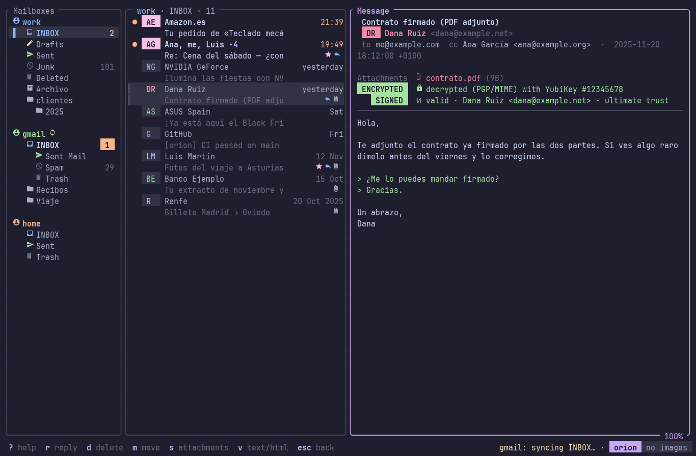

# Orion

A fast terminal mail client written in Rust, with native HTML and images,
OpenPGP (YubiKey included) and a background daemon for your status bar.



## Features

- **Protocols**: IMAP (with IDLE), POP3, JMAP and local mbox; SMTP and JMAP
  for sending. Gmail, Outlook (OAuth), iCloud and your own server are set up
  with `orion account add`.
- **Fast**: a local SQLite cache, incremental sync and lists of 100k messages
  that stay instant.
- **HTML, natively**: a built-in HTML/CSS renderer for the terminal, and an
  optional pixel-exact "original view" drawn by headless Chromium, offline and
  sandboxed.
- **Images** with sixel, kitty or iTerm2 (halfblocks elsewhere); remote images
  are only fetched when you ask (tracking pixels never).
- **OpenPGP** through GnuPG: decrypt, verify, sign and encrypt (PGP/MIME),
  YubiKey/OpenPGP cards with a built-in PIN prompt, Autocrypt, keyserver lookup.
- **Daemon** (`orion daemon`): new-mail notifications, a hook, and a JSON API
  on a Unix socket for status bars (Waybar and waymobar samples in `contrib/`).
- **Looks**: Catppuccin themes, Nerd Font icons, three-pane layout; every key
  is configurable.

## Requirements

- Rust 1.98 or newer to build.
- Optional: `gpg` (OpenPGP), `chromium` (original HTML view), a Nerd Font
  (icons), `secret-tool` (GNOME Keyring for passwords and tokens), a terminal
  with sixel or kitty graphics (foot, kitty, ghostty, WezTerm…).

## Install

```sh
git clone https://github.com/prietus/orion
cd orion
cargo build --release
install -Dm755 target/release/orion ~/.local/bin/orion
orion account add            # guided: finds the servers, signs in
orion                        # start
```

## Status

| Phase | Content | Status |
|---|---|---|
| 1 | Core, mbox backend, reading TUI, images, configurable keys | ✅ |
| 2 | IMAP + local cache (sqlite) + background loading | ✅ |
| 3 | Native HTML renderer (CSS subset, tables, inline images, numbered links) | ✅ |
| 4 | OpenPGP via GnuPG (gpg-agent/scdaemon): decrypt and verify, YubiKey with built-in PIN prompt | ✅ |
| 4b | Native sequoia + openpgp-card backend (YubiKey without gpg) | ⏳ |
| 4c | Background daemon: new-mail detection, notifications, hook, JSON API over a Unix socket | ✅ |
| 5 | JMAP, POP3 and IMAP IDLE (instant new mail) | ✅ |
| 6 | Compose and send: `$EDITOR`, reply/forward, SMTP (incl. XOAUTH2) and JMAP, PGP/MIME sign/encrypt, copy in Sent | ✅ |

## Usage

```sh
cargo build --release
./target/release/orion --mbox testdata/demo.mbox     # no configuration needed
./target/release/orion --print-config > ~/.config/orion/config.toml
./target/release/orion                               # uses the configuration
```

Press `?` inside Orion to see every key binding.

### Writing mail

Orion writes mail in its own panel (`[ui] composer = "builtin"`, the default):
`To`/`Cc`/`Bcc` suggest addresses from your address book as you type (↑↓ to
choose, Enter/Tab/`,` to add, Backspace on an empty field removes the last
one), then the subject, then the body in a Vim-like editor (`i`, `Esc`, `dd`,
`u`…). `Tab` moves between fields, `Ctrl-S` sends, `Ctrl-A` attaches,
`Ctrl-X` drops the last attachment, `Ctrl-G` sign, `Ctrl-K` encrypt, `Ctrl-L`
looks up missing keys, `Ctrl-Y` accepts them, `Ctrl-E` opens everything in
`$EDITOR` and comes back, `Ctrl-Q` closes (the draft is kept).

Suggestions come from `[contacts] sources`, in order: `"eds"` (GNOME /
Evolution address books, including GNOME Online Accounts such as iCloud or
Google, read over D-Bus without seeing their passwords), `"mail"` (people
who wrote to you), `"vcard:<file or folder>"`, and `"command:<cmd>"` (lines
`email<TAB>name`, the mutt query format: khard, abook…). `orion contacts
[text]` searches it from the shell.

With `composer = "editor"` Orion goes straight to your editor instead:

`c` new message, `r` reply, `R` reply to all, `f` forward (reload moved to
`Ctrl-R`/`F5`). Orion opens your `$VISUAL`/`$EDITOR` with a template:

```
From: Ana <ana@example.org>
To: Bob <bob@example.org>
Cc:
Bcc:
Subject: Re: Lunch?
Attach: ~/Documents/map.pdf

Yes, see you there!

On 2025-11-20 12:00:00 +0100, Bob <bob@example.org> wrote:
> Noon at the usual place?
```

When the editor closes, a review screen shows the message: `y` send, `e` edit
again, `a` attach, `d` drop the last attachment, `S` sign, `E` encrypt, `q`
close. `a` opens a file browser (starts in the last folder used, else
`~/Downloads`): type to filter fuzzily, Enter opens a folder or attaches,
Space marks several files, Backspace goes up, Ctrl-T shows hidden files; a
typed or pasted path (`/…`, `~/…`, `file://…`, as terminals paste on drag and
drop) is used directly. Replies keep the thread (`In-Reply-To`/`References`) and never include
yourself; answering an encrypted message starts with encryption on.

- **OpenPGP**: signed messages are PGP/MIME `multipart/signed` (with the
  `micalg` gpg really used); encrypted ones are also encrypted to you, so your
  copy in Sent stays readable, and their subject is protected (`...` outside).
  Recipients without a key are named; `k` looks them up over WKD. Signing with
  a YubiKey asks for its PIN in the status bar.
- **Look**: Catppuccin themes (`[ui] theme = "mocha" | "macchiato" | "frappe" |
  "latte"`, or `"terminal"` for the terminal's own 16 colours), Nerd Font icons
  (`[ui] icons = false` for plain symbols), and a two-line message list with
  relative dates (`[ui] list_style = "compact"` for one line per message).
  `ORION_SHOT_DIR=dir cargo test -p orion-tui screenshots -- --ignored` plus
  `scripts/render_shot.py` produce PNG screenshots for design work.
- **Conversations**: the list groups messages that answer each other
  (`Message-ID`, `In-Reply-To`, `References`) into one row: who took part, how
  many messages (`▸3`), the newest date, and unread/flag/attachment marks if
  any message has them. `t` expands a conversation (its older messages below,
  as a tree) or collapses it; `T` switches grouping off and on
  (`[ui] threads = false` starts without it).
- **Three panes** when the window is wide (`[ui] layout = "auto"`, or
  `"three-pane"` / `"stacked"`): folders | list | message. Moving through the
  list previews the selected message (after a short pause, so holding `j` does
  not download each one); it counts as read after `mark_read_after` seconds on
  screen (default 2; Enter goes into it and marks it at once; Esc returns to
  the list). Encrypted messages ask for the PIN only after Enter.
- **Attachments**: `s` lists the open message's attachments: Enter saves one
  to `~/Downloads`, `a` saves all, `o` opens one with `open_command`. Names
  from the message are sanitised (no paths, no hidden files) and existing
  files are never overwritten ("name (1).pdf").
- **Delete and move**: `d` moves the message to the account's Trash (IMAP
  special-use `\Trash` or the usual names, JMAP role `trash`; inside the Trash
  or Spam it asks to delete for good instead), `D` deletes for good after
  asking, `X` empties the Trash or Spam folder (after asking), `m`
  moves it to another folder (type to filter). IMAP uses `UID MOVE` when the
  server has it, else copy + `\Deleted` + `UID EXPUNGE` (only those messages);
  POP3 can only delete (`DELE`, on the server). The message leaves the list at
  once and comes back if the server refuses.
- **Original view** (`V`): the HTML as designed, drawn by headless Chromium
  into an image shown with sixel/kitty (needs `chromium`; `[ui]
  html_renderer` picks another browser). Locked down: `<script>` removed, a
  Content-Security-Policy that forbids scripts and every network load, a dead
  proxy and a throwaway profile; only embedded images and the remote ones
  already loaded with `L` are shown. It is an image: text cannot be selected,
  but each link carries its number in a small badge (as in the text view;
  `[ui] link_markers = false` hides them), so `o` + number opens it. `V`
  again goes back.
- **Remote images** (hosted on the internet, not attached) are never fetched
  by default: downloading them tells the sender you opened the message, when
  and from where. The reader says how many there are; `L` downloads them for
  that message only (no cookies, no Referer, only `image/*`, size limits, and
  1×1 tracking pixels skipped). `[ui] remote_images = "ask" | "always" | "never"`.
- **Learning keys from mail**: when a message brings its sender's key (an
  `Autocrypt:` header, an attached key, or just the fingerprint of an unknown
  signature, then fetched from the keyservers), the reader shows it with its
  fingerprint; `I` imports it and accepts it for that address only if the key
  carries it. Nothing is imported automatically (a forged From could plant a
  key). Orion also sends your key in an `Autocrypt:` header
  (`[pgp] autocrypt = true`), and `pgp_key` per account picks another key to
  sign with. Keys you accept after comparing fingerprints are remembered in
  `~/.local/share/orion/accepted-keys`.
- **Sending**: JMAP accounts submit through JMAP. Others use `[account.smtp]`
  (written by `orion account add`): implicit TLS or STARTTLS (never falls back
  to plain text), AUTH PLAIN/LOGIN, or XOAUTH2 for Outlook with the same
  Microsoft sign-in. If a recipient is rejected nothing is sent.
- **Sent copy**: appended to the server's Sent mailbox (found by its IMAP
  special-use flag or usual name, created if missing). Gmail files sent mail
  itself, so Orion skips it there (`save_sent` overrides). A failure to save
  the copy is reported as a warning: the message did go out.
- **Drafts never get lost**: the draft lives in `~/.local/share/orion/drafts/`
  (mode 0600) until it is sent.
- Bcc recipients only go in the SMTP envelope, never in the message.
- The `Message-ID` uses your address's domain, not this machine's name.

Per account: `from = "Ana García <ana@example.org>"`, `signature = "..."`,
`save_sent = true|false`. In `[pgp]`: `sign_by_default`, `encrypt_when_possible`.

### Adding accounts

```sh
orion account add you@icloud.com     # detects the provider and guides you
orion account test                   # connects to every account, prints counts
orion account login <name>           # sign in again / replace a password
orion account list
```

`orion account add` recognises iCloud, Gmail, Yahoo and Fastmail (it opens
their app-password page) and Outlook/Hotmail/Live (it signs in with
Microsoft: you open `microsoft.com/devicelogin` on any device, enter the code
and approve it in Authenticator; IMAP then uses XOAUTH2 and tokens refresh by
themselves). For other domains it asks **only that domain**: its autoconfig
file over HTTPS and its DNS SRV records. SRV answers pointing outside the
domain must be confirmed unless they were DNSSEC-validated by a resolver
running on this machine (an AD bit from a remote resolver is not trusted).

The connection is tested before anything is saved. Passwords and OAuth tokens
go to the system keyring (Secret Service via `secret-tool`); the config only
gets a `password_command` that reads them back, or `oauth = "microsoft"`.

### Protocols

| Backend | Mailboxes | Flags | New mail | Notes |
|---|---|---|---|---|
| `mbox` | file or directory | session only | poll | read-only |
| `imap` | all, hierarchy, UTF-7 names | on the server | **IDLE** (instant) + poll | UIDVALIDITY/UIDNEXT deltas |
| `pop3` | INBOX | kept in the local cache | poll | UIDL ids; only new headers (`TOP`, pipelined); never deletes |
| `jmap` | all, nested, roles | keywords on the server | poll | Basic or Bearer auth; session discovery |

TLS everywhere uses rustls with the system certificate store: `tls = "tls"`
(implicit), `"starttls"` (IMAP STARTTLS / POP3 STLS) or `"none"` (local
testing only).

```toml
[[account]]
name = "isp"
backend = "pop3"
host = "pop.example.net"
tls = "tls"
user = "me"
password_command = "pass show mail/isp"

[[account]]
name = "fastmail"
backend = "jmap"
url = "https://api.fastmail.com/jmap/session"   # or just https://host
auth = "bearer"                                   # basic needs `user`
password_command = "pass show mail/fastmail-token"
```

IMAP accounts use IDLE by default (`idle = true`): a second connection waits
on the first watched mailbox and new mail is synced as soon as the server
announces it.

### Tests

`cargo test` runs everything it can on the machine:

- Real **Dovecot** (if installed): IMAP, POP3, IDLE, implicit TLS and
  STARTTLS/STLS with a throwaway CA. Each test starts its own unprivileged
  Dovecot on free localhost ports.
- `scripts/fake_imap.py` and `scripts/fake_jmap.py`: small fake servers for
  edge cases (dropped connections, UIDVALIDITY changes, JMAP redirects,
  relative URLs, pagination, batching).
- Real **GnuPG** in a temporary home for OpenPGP.

Tests that need a missing tool are skipped, not failed.

### Background daemon and local API

`orion daemon` runs the same account threads as the UI, without a screen: it
syncs, checks the **watched** mailboxes for new mail (per account,
`watch = ["INBOX"]` by default, `["*"]` for all), sends desktop notifications
(`notify-send`) and runs an optional `on_new_mail` hook. The hook gets the
details in environment variables (`ORION_ACCOUNT`, `ORION_MAILBOX`,
`ORION_COUNT`, `ORION_FROM`, `ORION_SUBJECT`, `ORION_UNREAD`); they are never
interpolated into the command, so a crafted subject cannot inject shell code.
The first sync after start only records a baseline (no notification storm).

The API is a Unix socket (`$XDG_RUNTIME_DIR/orion.sock`, mode 0600) speaking
JSON, one object per line:

```sh
$ echo '{"cmd":"status"}' | socat - UNIX-CONNECT:$XDG_RUNTIME_DIR/orion.sock
{"ok":true,"status":{"version":"0.1.0","unread":3,"unread_all":5,"accounts":[...]}}
```

| Request | Reply |
|---|---|
| `{"cmd":"status"}` | accounts, mailboxes (total/unread/watched), last sync, errors |
| `{"cmd":"sync"}` | checks all accounts now |
| `{"cmd":"reload"}` | re-reads the counts from the shared cache, no network (the UI sends it after marking mail read, so status bars follow at once) |
| `{"cmd":"subscribe"}` | then a stream of `new_mail`, `counts` and `error` events |
| `{"cmd":"ping"}` | `{"ok":true}` |

Built-in clients: `orion status` (`--json`, `--waybar`), `orion watch`
(`--json`), `orion sync`. See `contrib/orion.service` (systemd user unit),
`contrib/waybar.jsonc` (Waybar module) and `contrib/waymobar.hs` (waymobar
widget).

### Reading HTML

Orion lays out HTML itself (no w3m or lynx). It supports:

- CSS from `<style>` (selectors with specificity, `!important`, no `@media`)
  and inline `style=`; legacy attributes (`bgcolor`, `<font color>`, `align`).
- Hidden text typical of newsletters (preheaders with `display:none`,
  `font-size:0`, `max-height:0`…) and tracking pixels: they are discarded.
- Paragraphs, headings, nested lists, quotes, `pre`, horizontal rules.
- Tables: automatic column widths (minimum/natural, like a browser); layout
  tables are placed side by side when they fit, data tables (`border`) get
  separators.
- Embedded images (`cid:`) inside the text, clipped while scrolling
  (sixel/kitty/halfblocks). Remote images are not downloaded (privacy): their
  alt text is shown instead.
- Numbered links `[n]` with a links footer; `o` + number + Enter opens them
  with `open_command` (http, https and mailto only).
- Colours: `html_colors = "auto"` drops colours that are unreadable on the
  terminal background (detected when the terminal reports it) and drops
  backgrounds.

`v` toggles between the HTML and the text version.

### OpenPGP and YubiKey

Orion uses `gpg` (its `--status-fd` interface), so it works with your GnuPG
setup and with keys on a YubiKey/Nitrokey through scdaemon.

- Encrypted and signed PGP/MIME (RFC 3156), protected headers (inner
  subject) and inline PGP (`BEGIN PGP MESSAGE` / `SIGNED MESSAGE`).
- When an encrypted message is opened, decryption is attempted without
  asking: if the PIN is cached (the YubiKey keeps it while plugged in) it just
  works. Otherwise Orion asks for the PIN in its status bar (masked) and hands
  it to gpg via *loopback*, so no terminal pinentry breaks the screen. With
  `pinentry = "agent"` gpg-agent's pinentry asks instead (only use it with a
  graphical one).
- Clear errors: wrong PIN (with remaining attempts), blocked PIN, card not
  connected, touch not confirmed, missing private key.
- Signatures: valid / tampered / unknown key / expired / revoked, with the
  trust level. Keys are never fetched automatically (privacy).
- `Y` shows the card status (holder, fingerprints, PIN attempts).
- Decrypted text only lives in memory: the cache stores the encrypted message.

### IMAP account

```toml
[[account]]
name = "work"
backend = "imap"
host = "imap.example.com"
tls = "tls"                 # tls (993) | starttls (143) | none
user = "me@example.com"
password_command = "pass show mail/work"
poll_interval = 120         # seconds between checks
cache_bodies = true
```

The cache lives in `~/.cache/orion/cache.sqlite` (`--cache` for another path,
`--no-cache` to disable it). On start-up the last known state is shown
instantly and syncing happens in the background; without network you can
keep reading everything that was already downloaded.

### Runtime architecture

```
input thread ─────┐
account thread 1 ─┼──► event channel ──► UI loop (never blocks)
account thread N ─┘         ▲
image decoding ─────────────┘
```

Each account has its own thread with its backend and its SQLite connection.
IMAP sync is incremental (UIDVALIDITY/UIDNEXT): it only downloads new
headers and the flags of known ones, and checks that what was received
matches `EXISTS` before touching the cache.

## Layout

```
crates/
  orion-core      model, Backend trait, configuration, MIME parsing, HTML→text
  orion-backends  mbox (mmap + memchr + rayon), IMAP + IDLE (async-imap), POP3, JMAP (ureq); rustls
  orion-store     SQLite cache: mailboxes, envelopes, sync state, bodies
  orion-html      HTML+CSS → styled document → layout at a given width
  orion-crypto    GnuPG: decrypt, verify, encrypt, sign, card status; PGP/MIME
  orion-tui       `orion` binary (ratatui + ratatui-image), account threads
scripts/fake_imap.py   minimal IMAP server for the tests
testdata/demo.mbox
```

Reference performance (aarch64, 6 cores): a 50,000-message / 10 MB mbox is
indexed in ~8 ms; opening a message takes ~15 µs.
`cargo run --release -p orion-backends --example index_bench -- <mbox>`

## License

Licensed under either of

- Apache License, Version 2.0 ([LICENSE-APACHE](LICENSE-APACHE) or
  <http://www.apache.org/licenses/LICENSE-2.0>)
- MIT license ([LICENSE-MIT](LICENSE-MIT) or <http://opensource.org/licenses/MIT>)

at your option.

Unless you explicitly state otherwise, any contribution intentionally submitted
for inclusion in the work by you, as defined in the Apache-2.0 license, shall be
dual licensed as above, without any additional terms or conditions.
