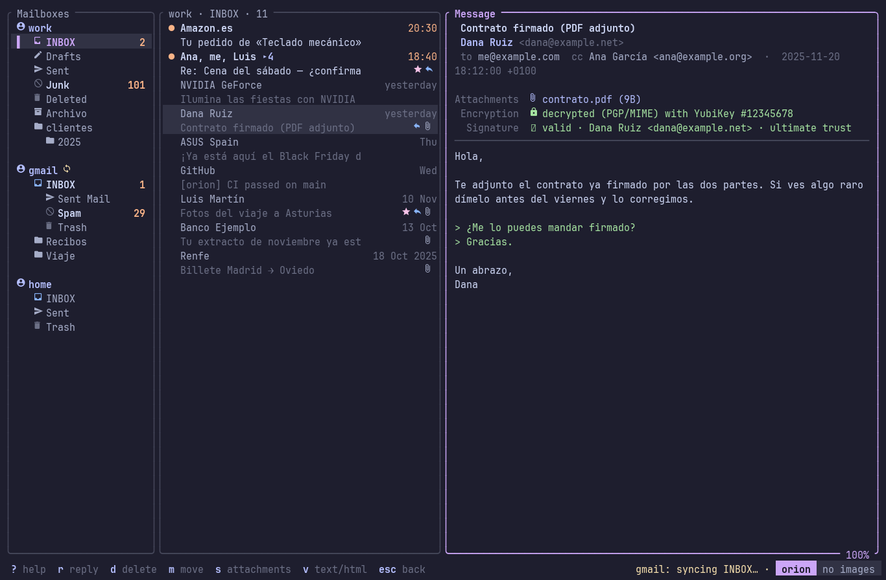

# Getting started

## 1. Add an account

```sh
orion account add you@example.org
```

Orion recognises the big providers and guides you through what each needs:

| Provider | What happens |
|---|---|
| **iCloud**, **Gmail**, **Yahoo**, **Fastmail** | Orion opens the provider's *app password* page; you create one and paste it. |
| **Outlook**, **Hotmail**, **Live** | Orion signs in with Microsoft: open `microsoft.com/devicelogin` on any device, type the code, approve it. Tokens refresh by themselves. |
| **Your own domain** | Orion asks *only that domain*: its autoconfig file over HTTPS and its DNS SRV records, and proposes the servers. |

The connection is tested before anything is saved. Passwords and tokens go to
the system keyring; the configuration file only gets a command that reads them
back.

Other account commands:

```sh
orion account list              # what is configured
orion account test              # connect to every account and print counts
orion account login <name>      # sign in again, or replace a password
```

## 2. Start Orion

```sh
orion
```

The first sync downloads the headers of your folders (a big Outlook inbox
takes about a minute); after that only what is new is fetched, and Orion
starts instantly from its cache.

With a wide window you get three panes: **folders | list | message**.



## 3. The essential keys

| Key | What it does |
|---|---|
| `j` `k` / arrows | move |
| `Tab` | switch pane |
| `Enter` | open the folder / message |
| `Esc` | back |
| `c` / `r` / `R` / `f` | write / reply / reply to all / forward |
| `d` | move to the Trash |
| `m` | move to another folder |
| `/` | search the list |
| `t` | expand or collapse a conversation |
| `v` / `V` | text ↔ HTML / the HTML as designed |
| `?` | every key |

The full list is in [Keys](reference/keys.md), and every key can be rebound in
the [configuration file](reference/config.md).

## 4. Make it yours

```sh
orion --print-config > ~/.config/orion/config.toml   # only if you have none yet
```

The file documents every option. Popular ones:

```toml
[ui]
theme = "mocha"          # mocha, macchiato, frappe, latte, terminal
layout = "auto"          # three panes when wide
threads = true           # group conversations
composer = "builtin"     # or "editor" for $EDITOR

[contacts]
sources = ["eds", "mail"]
```

## 5. Optional: the daemon

`orion daemon` keeps checking for new mail in the background, sends desktop
notifications and feeds your status bar. See
[Daemon and status bars](daemon.md).
