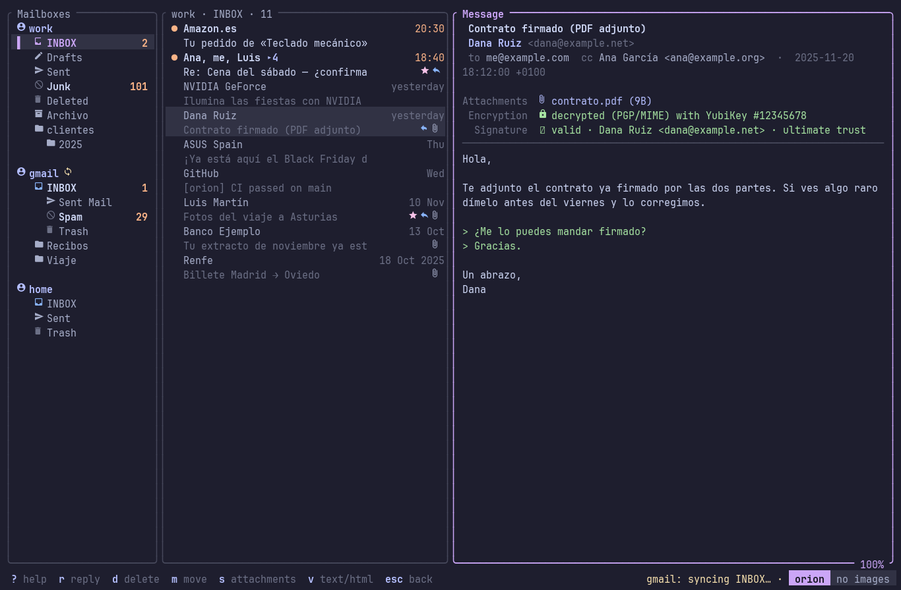

# Orion

**A fast terminal mail client written in Rust**, with native HTML and images,
OpenPGP with YubiKey support, conversations, and a background daemon for your
status bar.



## Why Orion

- **Every protocol you need**: IMAP (with IDLE for instant new mail), POP3,
  JMAP and local mbox; SMTP and JMAP for sending. Gmail, Outlook (Microsoft
  sign-in), iCloud and your own server are set up with one command.
- **Fast**: a local SQLite cache, incremental sync, and lists of 100,000
  messages that stay instant. Everything you already downloaded can be read
  offline.
- **HTML, natively**: a built-in HTML/CSS renderer made for the terminal, plus
  an optional pixel-exact *original view* drawn by headless Chromium — offline
  and locked down.
- **Images** with sixel, kitty or iTerm2 graphics (halfblocks elsewhere).
  Remote images are only fetched when you ask, and tracking pixels never.
- **OpenPGP** through GnuPG: decrypt, verify, sign and encrypt (PGP/MIME),
  YubiKey and other OpenPGP cards with a built-in PIN prompt, Autocrypt and
  keyserver lookup.
- **Conversations**: replies are grouped with what they answer, including your
  own replies from the Sent folder.
- **A real compose panel**: address suggestions from your address book (GNOME
  Online Accounts, vCard, khard…), a Vim-like body editor, attachments with a
  file browser — or your own `$EDITOR` if you prefer.
- **Daemon** (`orion daemon`): desktop notifications, a hook for your own
  scripts, and a JSON API on a Unix socket for status bars (Waybar and
  waymobar samples included).
- **Looks**: Catppuccin themes, Nerd Font icons, a three-pane layout. Every key
  can be rebound.

## Quick start

```sh
git clone https://github.com/prietus/orion
cd orion
cargo build --release
install -Dm755 target/release/orion ~/.local/bin/orion

orion account add you@example.org   # finds the servers and signs you in
orion                               # start reading
```

Press ++question++ inside Orion to see every key. New here? Read
[Getting started](getting-started.md).

## Status

Orion is young but used daily on real Gmail, Outlook and self-hosted
(Postfix/Dovecot) accounts. The test suite runs against a real Dovecot, real
GnuPG and fake servers for the edge cases. Bug reports are welcome on
[GitHub](https://github.com/prietus/orion/issues).
