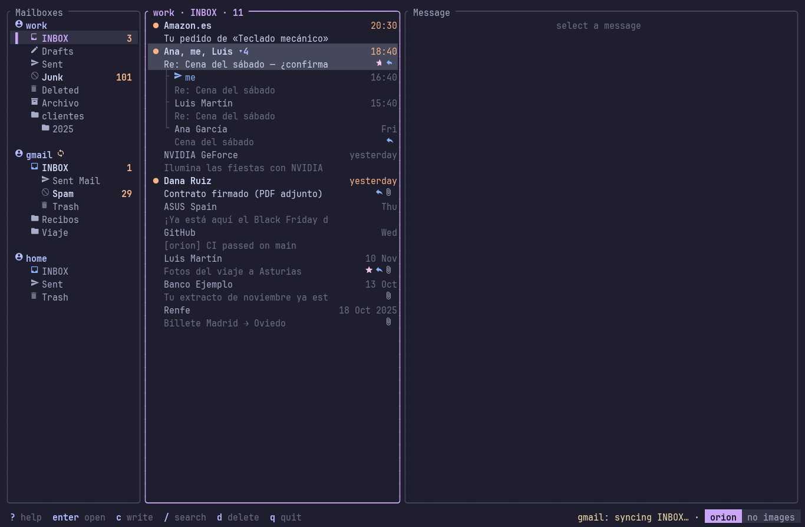

# Reading mail

## The layout

When the window is wide enough, Orion shows three panes: **folders**, the
**message list** and the **message**. Moving through the list previews the
selected message on the right (after a short pause, so holding `j` does not
download every message on the way). `Enter` goes into the message to scroll,
reply or save attachments; `Esc` comes back to the list.

On narrower windows the message replaces the list. `[ui] layout` chooses:
`"auto"` (default), `"three-pane"` or `"stacked"`.

### When a message counts as read

A previewed message is marked read after it has been on screen for
`mark_read_after` seconds (2 by default), like Thunderbird: running through
the list does not mark everything read. `Enter` marks it at once. `N` toggles
read/unread by hand.

## The message list

Each row shows the sender and a relative date ("14:32", "yesterday", "Mon",
"12 Nov"), with the subject below. Unread messages carry an orange dot;
icons mark flagged, answered and with-attachment messages.

`[ui] list_style = "compact"` packs one message per line.

## Conversations

Messages that answer each other — through their `Message-ID`, `In-Reply-To`
and `References` headers, the same ones Gmail and Thunderbird use — are
grouped into a single row:



```
● Ana, me, Luis ▸4                         18:27
  Re: Cena del sábado — ¿confirmamos…
```

- Who took part (newest first) and how many messages (`▸4`).
- The date of the newest message; the conversation moves to the top when a
  reply arrives.
- The unread dot and the icons show if *any* message of the conversation has
  them.
- **Your own replies**, from the account's Sent folder, appear inside the
  conversations they belong to (marked *me*). Opening, deleting or moving one
  acts on Sent. Sent mail that answers nothing in the open folder stays out.

| Key | What it does |
|---|---|
| `Enter` | open the newest message of the conversation |
| `t` | expand the conversation (older messages below, as a tree) / collapse it |
| `T` | switch grouping off and on (`[ui] threads = false` starts without it) |

## Searching

`/` filters the list by subject and sender as you type; `Esc` clears the
filter.

## Flags, deleting and moving

| Key | What it does |
|---|---|
| `N` | read / unread |
| `F` | flag / unflag as important |
| `d` | move to the account's Trash — inside the Trash or Spam it asks to delete for good |
| `D` | delete for good (asks first) |
| `X` | empty the Trash or Spam folder (asks first; refuses any other folder) |
| `m` | move to another folder: type part of its name, `Enter` |

The message leaves the list at once and comes back if the server refuses.
IMAP uses `UID MOVE` when the server supports it, else copy + `\Deleted` +
`UID EXPUNGE` on just those messages. POP3 can only delete (on the server).

## Attachments

`s` lists the open message's attachments:

| Key | What it does |
|---|---|
| `Enter` | save it to `~/Downloads` |
| `a` | save them all |
| `o` | open it with its program (`xdg-open`) |

File names coming from a message are sanitised (`../../.bashrc` is saved as
`bashrc` inside Downloads) and existing files are never overwritten
(`contrato (1).pdf`).

## Links

Links are numbered `[1]`, `[2]`… in the text. `o`, the number and `Enter`
opens one with `open_command` (http, https and mailto only).

## Reloading

`Ctrl-R` (or `F5`) checks every account now. With IMAP IDLE new mail usually
appears by itself within seconds.
