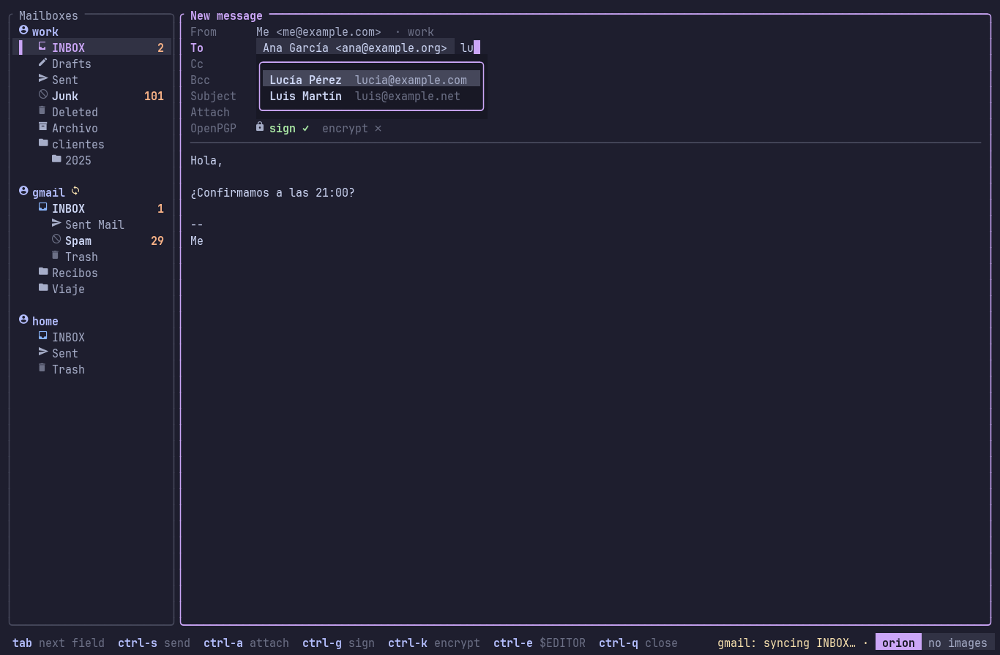

# Writing mail

`c` writes a new message, `r` replies, `R` replies to all, `f` forwards.

## The compose panel



| Field | How it works |
|---|---|
| **To / Cc / Bcc** | Type a name or an address: suggestions from your address book appear below. `↑↓` choose, `Enter`/`Tab`/`,` add it. Added recipients become *chips*; `Backspace` on an empty field removes the last one. A full address can also be typed. |
| **Subject** | `Enter` goes on to the body. |
| **Body** | A Vim-like editor: `i` to insert, `Esc` for normal mode, `dd`, `u`, `w`, `b`… The mode is shown on the separator line. Replies start writing above the quote, in insert mode. |

| Key | What it does |
|---|---|
| `Tab` / `Shift-Tab` | next / previous field (in the body only outside insert mode) |
| `Ctrl-S` | send |
| `Ctrl-A` | attach files (file browser) |
| `Ctrl-X` | remove the last attachment |
| `Ctrl-G` | sign on/off |
| `Ctrl-K` | encrypt on/off |
| `Ctrl-L` | look up missing recipient keys (WKD, keyservers) |
| `Ctrl-Y` | accept the keys found, after comparing their fingerprints |
| `Ctrl-E` | open everything in `$EDITOR` and come back |
| `Ctrl-Q` / `Esc` | close (twice); the draft is kept |

Text in an address field that is not an address is never dropped: the cursor
stays there until you fix it.

## Address suggestions

`[contacts] sources` lists where suggestions come from, in order of
preference:

| Source | What it is |
|---|---|
| `"eds"` | GNOME / Evolution address books — including **GNOME Online Accounts** (iCloud, Google, Nextcloud, CardDAV…). Read over D-Bus with your session: Orion never sees those accounts' passwords. |
| `"mail"` | people who wrote to you, from Orion's cache (automated senders such as `noreply@` left out) |
| `"vcard:~/Contacts"` | a `.vcf` file or a folder of them (vdirsyncer, khard, exported from a phone) |
| `"command:khard email --parsable"` | any program printing `email<TAB>name` lines — the mutt query format (khard, abook…) |

```toml
[contacts]
sources = ["eds", "mail"]
```

Search ignores accents ("garcia" finds "García") and ranks your address books
first, then how often people write to you. From the shell:

```sh
orion contacts ana
```

## Attaching files

`Ctrl-A` (or `a` on the review screen) opens a file browser that starts in
the last folder you used, else `~/Downloads`:

| Key | What it does |
|---|---|
| typing | filter by name, fuzzily (`fct24` finds `factura_2024.pdf`) |
| `Enter` | open a folder / attach the file (or the marked ones) |
| `Space` / `Tab` | mark several files |
| `Backspace` | erase the filter, then go up a folder |
| `Ctrl-T` | show hidden files |

A typed or pasted path (`/…`, `~/…`, `file://…`) is used directly, so you can
drag a file from your file manager onto the terminal.

## Using your own editor

```toml
[ui]
composer = "editor"
editor = "nvim"      # default: $VISUAL, $EDITOR, then nano, nvim, vim, vi
```

Orion opens a template:

```
From: Ana <ana@example.org>
To: Bob <bob@example.org>
Cc:
Bcc:
Subject: Re: Lunch?
Attach: ~/Documents/map.pdf

Yes, see you there!

On 2025-11-20 12:00, Bob <bob@example.org> wrote:
> Noon at the usual place?
```

When the editor closes, a review screen shows the message: `y` send, `e` edit
again, `a` attach, `d` drop the last attachment, `S` sign, `E` encrypt, `q`
close.

## Sending

- **SMTP** with implicit TLS or STARTTLS (never falls back to plain text),
  AUTH PLAIN/LOGIN or XOAUTH2 (Outlook). JMAP accounts send through JMAP.
- If a recipient is rejected, **nothing** is sent.
- **Bcc** recipients only go in the SMTP envelope, never in the message.
- A copy is saved in the account's **Sent** folder (Gmail files it by itself;
  `save_sent` overrides). A failure to save the copy is a warning: the message
  did go out.
- Replies keep the conversation (`In-Reply-To`, `References`) and never
  include yourself.
- **Drafts are never lost**: they live in `~/.local/share/orion/drafts/` (only
  readable by you) until the message is sent.

Signing and encrypting are described in [OpenPGP and YubiKey](openpgp.md).
